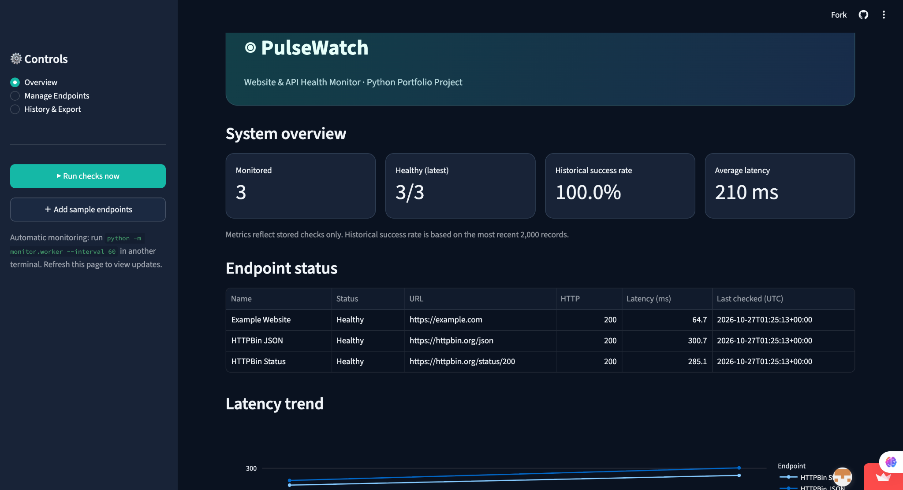
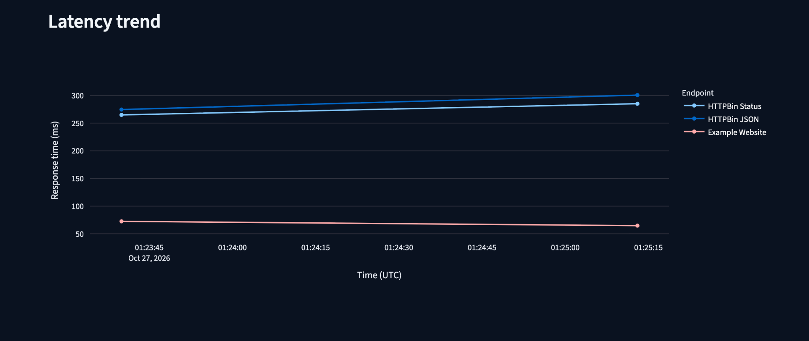
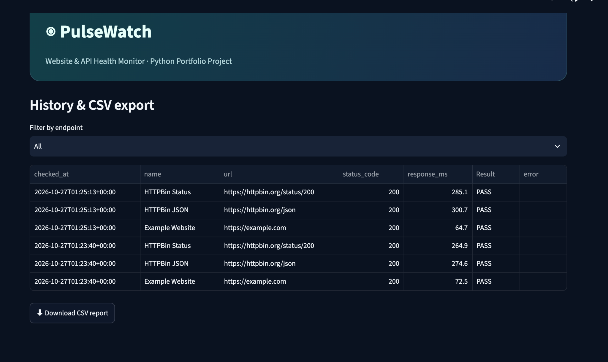

# 💚 PulseWatch — Website & API Health Monitor

[](https://github.com/naithikapingali/PulseWatch/actions/workflows/tests.yml)

PulseWatch is a Python-based website and REST API health monitoring application developed to explore software engineering, automated testing, and performance analytics.

Built with Python, Streamlit, Requests, SQLite, Pandas, and Plotly, the application provides an interactive dashboard for monitoring endpoint availability, tracking response times, and analyzing historical performance.

## Automated Testing

PulseWatch includes 9 automated tests using Pytest.

The test suite runs through GitHub Actions whenever
changes are pushed to the main branch.

**Latest verified result: 9 tests passed (100%).**

[View GitHub Actions Results](https://github.com/naithikapingali/PulseWatch/actions)

## Features
- Monitor HTTP/HTTPS endpoints using GET or HEAD
- Assert expected HTTP status and optional response text
- Store checks and response times in SQLite
- Track latest health, historical success rate and latency
- Edit, pause and delete endpoints
- Run checks manually or with an optional background worker
- Download filtered CSV reports
- Automated Pytest suite and GitHub Actions CI


## Screenshots

### 1. System Overview Dashboard

PulseWatch displays three monitored endpoints, their
latest health status, historical success rate, and
average response latency.



### 2. Response Latency Trend

The application visualizes response-time trends
across multiple monitoring checks.



### 3. Monitoring History and CSV Export

Monitoring history records HTTP status codes,
response times, timestamps, and check results.




## Project structure
```text
python-website-api-health-monitor/
├── app.py                        # Streamlit dashboard
├── monitor/
│   ├── __init__.py
│   ├── checker.py                # HTTP checks and validation
│   ├── database.py               # SQLite schema and CRUD
│   ├── service.py                # Monitoring orchestration
│   ├── seed.py                   # Sample endpoint configuration
│   └── worker.py                 # Optional scheduled checks
├── tests/
│   ├── test_checker.py
│   └── test_database.py
├── sample_data/endpoints.csv
├── .streamlit/config.toml
├── .github/workflows/tests.yml
├── requirements.txt
├── .gitignore
└── README.md
```

## Requirements
Python 3.10+ and internet access for live HTTP checks.

## Setup (macOS / Linux)
```bash
python3 -m venv .venv
source .venv/bin/activate
python -m pip install -r requirements.txt
python -m monitor.seed
streamlit run app.py
```

## Setup (Windows PowerShell)
```powershell
py -m venv .venv
.venv\Scripts\Activate.ps1
python -m pip install -r requirements.txt
python -m monitor.seed
streamlit run app.py
```
If PowerShell blocks activation, use `.venv\Scripts\python.exe -m pip install -r requirements.txt` and `.venv\Scripts\python.exe -m streamlit run app.py` instead.

Open the local URL printed by Streamlit (usually `http://localhost:8501`).

## Monitoring
Use **Run checks now** in the sidebar for manual checks. To monitor every 60 seconds, open **a second terminal** in the project directory, activate the same virtual environment, and run:
```bash
python -m monitor.worker --interval 60
```
The worker must remain running for scheduled checks. Refresh the dashboard to see new results. A one-off command is:
```bash
python -m monitor.worker --once
```
**Note:** Do not run multiple workers simultaneously against the same database. Streamlit alone does not schedule checks. The SQLite database is local and does not persist across ephemeral cloud deployments unless persistent storage is configured.

## Sample data
`sample_data/endpoints.csv` contains three example targets. `python -m monitor.seed` inserts them only when there are no existing endpoints. Live result history is generated when you run checks; sample results are not fabricated.

## Run tests
```bash
python -m pytest -q
```
Tests mock network responses, so they do not require external websites to be available.

## GitHub upload
1. Create a new **public** repository named `python-website-api-health-monitor` on GitHub (do not initialize it with a README).
2. From the project folder run:
```bash
git init
git add .
git commit -m "Initial commit: PulseWatch monitoring dashboard"
git branch -M main
git remote add origin https://github.com/YOUR_USERNAME/python-website-api-health-monitor.git
git push -u origin main
```
3. Replace `YOUR_USERNAME` with your GitHub username and authenticate using GitHub's supported login flow (e.g. credential manager or SSH).
4. Add screenshots of your running dashboard to a `screenshots/` directory and link them from this README.
5. Pin the repository to your GitHub profile.

## Design and security notes
This is a **local developer portfolio tool**, not a hardened public multi-user monitoring service. Configure only endpoints you own or are authorized to monitor. The UI accepts HTTP(S) URLs and does not block private/internal IP addresses, so **do not deploy it publicly without authentication and SSRF protection**. No authentication headers or secrets are stored. GET/HEAD checks may still cause side effects on poorly designed services. Keep intervals reasonable to avoid overwhelming monitored endpoints. Redirects are followed. Uptime shown is the success rate of recorded checks, not guaranteed continuous availability.

## Possible future enhancements
Email/Slack alerts, response-time thresholds, TLS expiry checks, authentication via secret manager, multi-user login, Docker Compose and deployment with persistent storage.

## Portfolio description
**PulseWatch** is a Python-based website and REST API health monitoring dashboard featuring automated endpoint checks, SQLite-backed history, Plotly latency analytics, CSV reports, Pytest coverage, and GitHub Actions CI.
